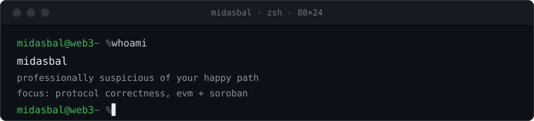

### `$` merged

**[Scale remaining order amounts exactly, not through basis points](https://github.com/ProjectOpenSea/seaport-js/pull/991)** &nbsp;`ProjectOpenSea/seaport-js#991` 
A basis-points detour under-scaled partial fills. On a 9 ETH order partially filled, the default fulfill path built a 5.9994 ETH transaction where the contract required 6, reverting an ordinary fill with `InsufficientNativeTokensSupplied`. Traced to a sibling fix that never reached these two functions, verified against seaport-core that the on-chain fill fraction is exact-or-revert, and covered by a regression test that fails on main with the exact wei mismatch.

**[Make the per-IP token bucket thread-safe under concurrent requests](https://github.com/flop-labs/technocore-chat/pull/163)** &nbsp;`flop-labs/technocore-chat#163` 
`take()` and `refund()` did an unlocked read-modify-write on the shared per-IP bucket map, and Starlette runs those sync handlers in a threadpool, so two requests from one IP could read the same bucket before either wrote back and both were granted: a lost update that lets a burst overspend its own rate limit. Closed it with a lock around both read-modify-write sites, and a regression test that forces the interleaving and runs red on main, green with the lock.

**[Classify unseal failures as a typed error to stop a doomed retry loop](https://github.com/FhenixProtocol/cofhesdk/pull/412)** &nbsp;`FhenixProtocol/cofhesdk#412` 
On the decryptForView path, an unseal failure (wrong key, tampered payload, malformed nonce) threw a plain `Error` instead of the `CofheError` the rest of the decrypt flow uses. So callers could not branch on `error.code`, and `useCofheDecrypt`, which only stops retrying on `CofheError`, kept re-submitting the whole seal-output request to the threshold network for a failure that is deterministic and can never succeed. Reclassified these as `CofheError` with code `SealOutputFailed`, with error context limited to byte lengths so no key material leaks, plus failure-path tests covering wrong key, corrupted payload, and malformed nonce.

### `$` more

- [`KeeperHub/keeperhub#2123`](https://github.com/KeeperHub/keeperhub/pull/2123) soft-delete regression that returned a false 409 on workflows whose run history was purged, traced to the commit and fixed.
- [`agentcommercekit/ack#176`](https://github.com/agentcommercekit/ack/pull/176) CAIP-2 namespace regex corrected to accept spec-legal hyphens, plus a test that had been passing for the wrong reason.
- [`getoptimum/optimum-common#191`](https://github.com/getoptimum/optimum-common/pull/191) a reusable uint64 chain_id parser for the shared library, closing the tracking issue.
- [`stellar/rs-soroban-sdk#2056`](https://github.com/stellar/rs-soroban-sdk/pull/2056) drifted `contractimport!` rustdoc examples corrected, a nonexistent wasm file and the wrong generated client name.
- [`magicblock-labs/ephemeral-spl-token#132`](https://github.com/magicblock-labs/ephemeral-spl-token/pull/132) the shuttle close path derived the same PDA twice across its two token branches; collapsed it to one derivation, behavior-preserving.

### `$` about

midasbal (Taylan Bal). Solo web3 developer, EVM and Soroban. Most of my useful work happens in the gap between what a contract promises and what it actually does. Currently moving into smart contract security and auditing, which is mostly this, with a job title.
